<!-- 01 HERO -->

  

<!-- 02 ABOUT -->

  

<!-- 03 SELECTED WORK -->

<!-- Project 01: ReviewFlow AI -->

  
  &nbsp;&nbsp;
  

 

<!-- Project 02: Curalink -->

  
  &nbsp;&nbsp;
  

 

<!-- Project 03: Support Desk -->

  
  &nbsp;&nbsp;
  

 

<!-- Project 04: Calendar Agent -->

  
  &nbsp;&nbsp;
  

 

<!-- Project 05: ShopAI -->

  
  &nbsp;&nbsp;
  

 

<!-- Project 06: Aura Finance -->

  
  &nbsp;&nbsp;
  

  

<!-- 04 EXPERIENCE -->

  

<!-- 05 TOOLKIT -->

  

<!-- 06 IMPACT -->

  

<!-- 07 COMMIT LOG & GITHUB TELEMETRY -->

 

  

<!-- 08 CONNECT -->

  
  &nbsp;&nbsp;
  
  &nbsp;&nbsp;
  
  &nbsp;&nbsp;
  
  &nbsp;&nbsp;
  

  

<!-- 09 FOOTER SIGNATURE -->

